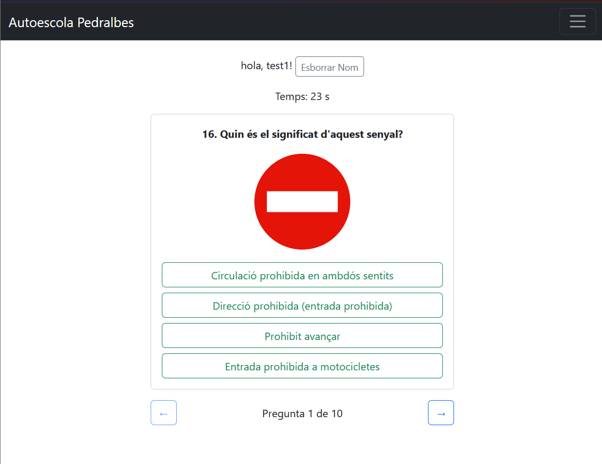
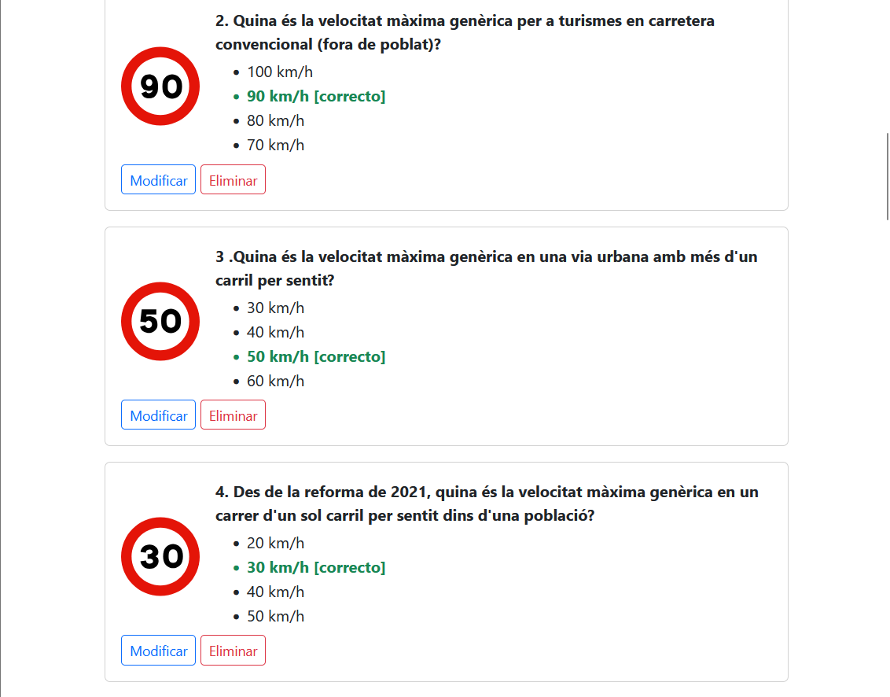
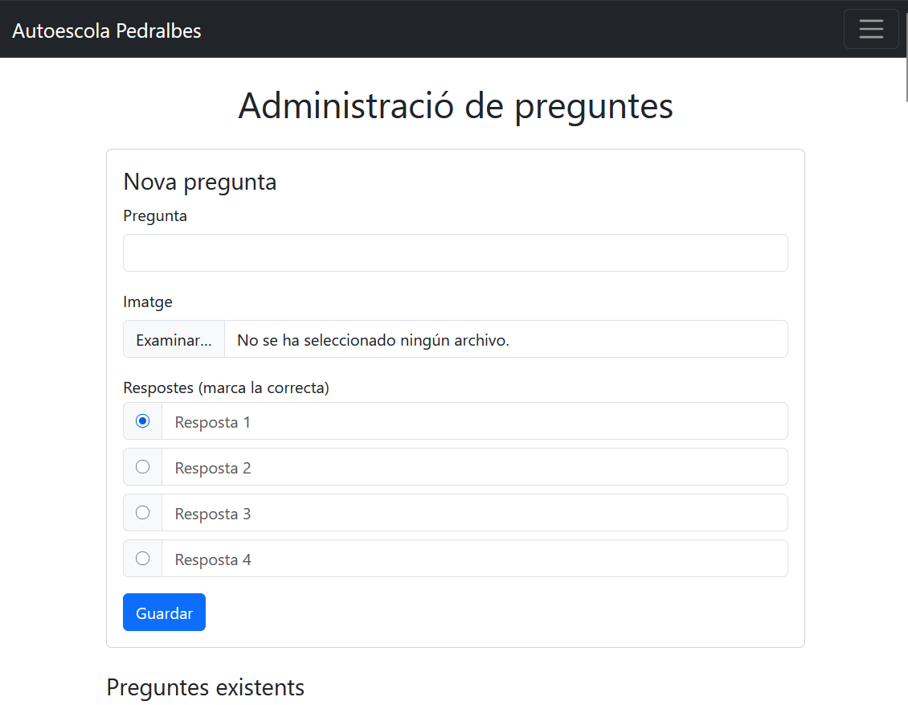

# Autoescola Quiz

Aplicación web tipo test para practicar el examen teórico del carnet de conducir. El jugador responde 10 preguntas aleatorias contra reloj y un panel de administración permite gestionar el banco de preguntas (con imágenes).

Proyecto de 2.º de DAW (Institut Pedralbes). La interfaz está en catalán.

| Juego | Administración |
|---|---|
|  |  |



## Funcionalidades

**Juego**
- 10 preguntas aleatorias por partida, con 30 segundos de tiempo.
- Navegación entre preguntas y barra de progreso.
- El nombre del jugador se guarda en `localStorage`.

**Administración (CRUD)**
- Crear, editar y eliminar preguntas con sus 4 respuestas.
- Subida de imágenes (máx. 2 MB, solo imágenes) con `multer`.

**Seguridad**
- La corrección se hace **en el servidor**: el cliente nunca recibe qué respuesta es la correcta.
- Cada partida tiene una sesión (UUID) que se borra al corregir, para que no se pueda reenviar.
- Consultas SQL parametrizadas para evitar inyección SQL.
- Credenciales fuera del código, en variables de entorno.

## Tecnologías

- **Backend:** Node.js, Express 5, MySQL, multer, uuid
- **Frontend:** HTML, CSS, JavaScript (vanilla), Bootstrap 5
- **Entorno:** Docker Compose (MySQL + Adminer)

## API

| Método | Ruta | Descripción |
|---|---|---|
| GET | `/json1` | Nueva partida: 10 preguntas aleatorias + `sessionId` |
| POST | `/respostes` | Corrige la partida y devuelve los aciertos |
| GET | `/preguntes` | Lista todas las preguntas |
| GET | `/preguntes/:id` | Una pregunta |
| POST | `/preguntes` | Crea una pregunta (multipart, con imagen opcional) |
| PUT | `/preguntes/:id` | Modifica una pregunta |
| DELETE | `/preguntes/:id` | Elimina una pregunta |

## Cómo ejecutarlo

Requisitos: Node.js 20.6 o superior y Docker (o un MySQL propio).

```bash
# 1. Base de datos (crea las tablas automáticamente)
docker compose up -d

# 2. Configuración
cp .env.example .env

# 3. Dependencias y datos iniciales
npm install
npm run migrate

# 4. Arrancar
npm start
```

- Juego: http://localhost:20100
- Administración: http://localhost:20100/admin.html
- Adminer (ver la BD): http://localhost:9090

## Estructura

```
app.js              Servidor Express y API
public/             Frontend (juego y panel de admin)
data/preguntes.json Preguntas iniciales
scripts/migrate.js  Carga las preguntas del JSON en MySQL
sql/schema.sql      Tablas de la base de datos
```

## Autor

Alex Brandao · [GitHub](https://github.com/alexbrandaodev23)
